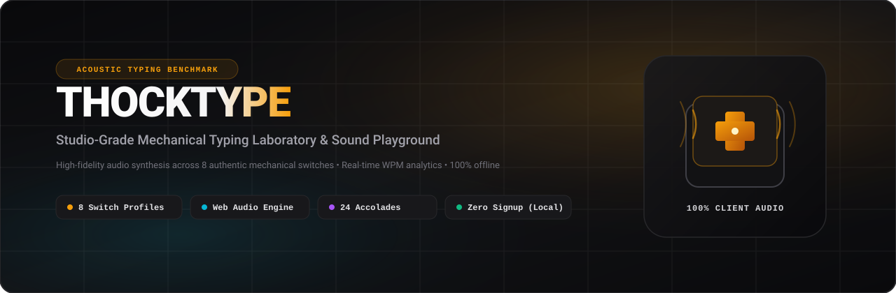
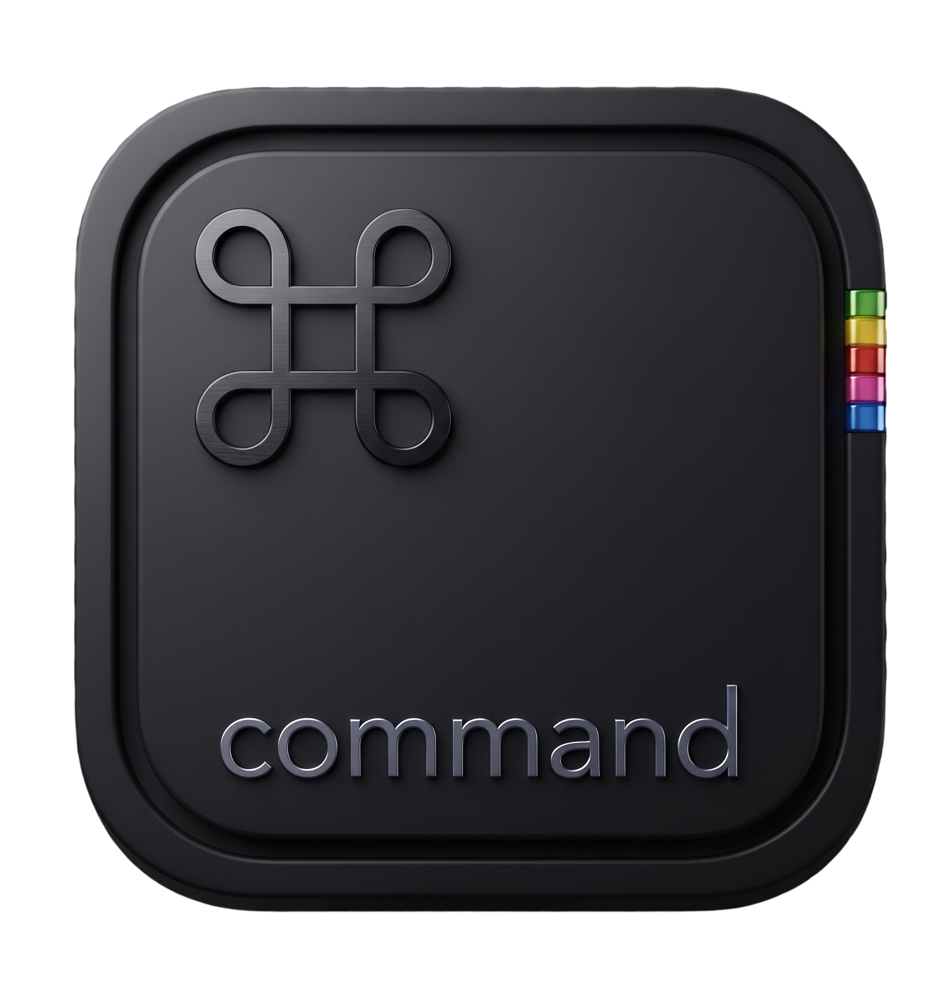

<div align="center">
  

  <br />
  <br />

  

  # THOCKTYPE

  <p>
    <strong>Studio-Grade Mechanical Typing Laboratory &amp; Acoustic Sound Playground</strong>
  </p>

  <p>
    An authentic, client-side mechanical typing platform featuring real-time acoustic synthesis across eight distinct mechanical switches, strict non-AI typing diagnostics, 24 milestone accolade honors, a 52-week activity heatmap, and 100% private local storage.
  </p>

  <p>
    <a href="https://nextjs.org"></a>
    <a href="https://react.dev"></a>
    <a href="https://www.typescriptlang.org"></a>
    <a href="https://tailwindcss.com"></a>
    <a href="https://developer.mozilla.org/en-US/docs/Web/API/Web_Audio_API"></a>
    <a href="LICENSE"></a>
  </p>
</div>

---

## Overview

THOCKTYPE is an open-source typing laboratory designed for mechanical keyboard enthusiasts, competitive typists, and developers. Built from scratch with Next.js 16 (Turbopack) and React 19, THOCKTYPE executes all acoustic synthesis, typing analytics, and progress tracking directly inside the user's browser without requiring an account, cloud database, or third-party telemetry.

---

## Core Features

### 1. Mechanical Switch Acoustic Engine
- **8 Authentic Sound Profiles**: Creamy Lubed, Ice Crystal, Heavy Tactile, Vintage Clack, Deep Thock, Bubble Pop, Spacebar Deep, and Hyper Type.
- **Micro-Pitch Variation**: Realistic frequency shifts on every keypress to eliminate artificial machine-gun effects.
- **Stereo Spatial Panning**: Keystrokes pan dynamically across the stereo field based on key placement across standard ANSI/ISO keyboard layouts.
- **Deskmat Resonance**: Optional sub-bass resonance filter simulating dense desk mat absorption.
- **Zero-Latency Playback**: Synthesized directly via browser Web Audio API (`AudioContext`, `GainNode`, `BiquadFilter`, `DynamicsCompressor`).

### 2. Strict Benchmark Diagnostics
- **Net vs. Raw Speed**: Computes both gross keystroke output (Raw WPM) and penalized accuracy speed (Net WPM) using the standard 5-character word formula.
- **Consistency & Rhythm Scoring**: Measures inter-keystroke variance (standard deviation in milliseconds) to assess pacing stability.
- **Trouble Key Detection**: Automatically captures error frequencies per character and surfaces top struggling keys for focused practice.
- **Flexible Test Durations**: Supports 15s, 30s, 60s, 120s, and unlimited endurance modes with Easy, Medium, and Hard vocabulary banks.

### 3. Distraction-Free Zen Focus Mode
- Clean full-screen workspace accessible via `Alt + F`.
- Strips away headers, navigation bars, and background distractions.
- Live WPM and accuracy meters that fade in only when actively typing.

### 4. 24 Milestone Honors & GitHub-Style Accolades
- Progressive achievement tiers: **Starter**, **Bronze**, **Silver**, **Gold**, and **Diamond**.
- Real-time milestone evaluation tracking test count, velocity thresholds, accuracy streaks, and multi-switch testing.
- Dedicated showcase page at `/badges` with progress meters, criteria breakdowns, and unlock timestamps.

### 5. Dynamic Profile Rank Halo Rings
- The user's profile avatar halo ring and backlight glow evolve automatically with highest benchmark records:
  - **Starter Typist** (0–44 WPM): Emerald border and glow
  - **Bronze Key** (45–64 WPM): Warm bronze metallic halo
  - **Silver Striker** (65–79 WPM): Polished platinum/zinc ring
  - **Gold Speedster** (80–99 WPM): Radiant gold ring
  - **Diamond Artisan** (100–119 WPM): Electric cyan glow
  - **Master Thocker** (120–139 WPM): Deep purple ultraviolet halo
  - **Grandmaster Elite** (140+ WPM): Fiery crimson rose aura

### 6. 100% Offline Local Storage & 52-Week Heatmap
- **Zero Signup**: Profiles are initialized automatically upon first visit.
- **52-Week Activity Heatmap**: Visualizes practice cadence, streak counts, and daily session volume across 365 days.
- **One-Click JSON Portability**: Export your complete benchmark history to a JSON file, or restore it on any device with one click.

### 7. Mobile-Optimized Responsive Interface
- Seamless touchscreen typing support with native on-screen keyboard compatibility.
- Interactive virtual keyboard with real-time key lights and touch audio triggers.
- Full-screen takeover navigation drawer and custom dark scrollbars matching the mechanical aesthetic.

---

## Mechanical Switch Catalog

| ID | Switch Name | Category | Acoustic Profile | Sound Characteristics |
|---|---|---|---|---|
| `s1` | Creamy Lubed | Linear | Deep / Low Pitch | Smooth factory-lubed glide with soft bottom-out |
| `s2` | Ice Crystal | Clicky | Crisp / High Pitch | Sharp metallic click with immediate tactile reset |
| `s3` | Heavy Tactile | Tactile | Solid / Medium Pitch | Pronounced tactile bump with clean return clack |
| `s4` | Vintage Clack | Clack | Bright / Medium Pitch | Classic 1980s retro terminal acoustic snap |
| `s5` | Deep Thock | Thock | Deep Bass / Low Pitch | Heavy polycarbonate housing with dense acoustics |
| `s6` | Bubble Pop | Pop | Bouncy / Medium Pitch | Light playful pop sound with rapid actuation |
| `s7` | Spacebar Deep | Thock | Ultra-Deep / Sub-Bass | Hollow wire-balanced spacebar resonance |
| `s8` | Hyper Type | Speed | Light / High Pitch | Short-travel competitive switch for rapid bursts |

---

## Keyboard Shortcuts

| Shortcut | Action | Scope |
|---|---|---|
| `Tab + Enter` | Instant Benchmark Restart | Global |
| `Alt + F` | Toggle Zen Focus Mode | Global |
| `Alt + T` | Navigate to Typing Benchmark | Global |
| `Alt + S` | Open Acoustic Sound Lab | Global |
| `Alt + M` | Cycle Difficulty Mode (Easy / Medium / Hard) | Test View |
| `Alt + ↑` / `Alt + ↓` | Master Volume Tuning (+/- 10%) | Global |
| `Alt + 1` .. `Alt + 8` | Hot-Swap Active Mechanical Switch Pack | Global |
| `?` | Toggle Global Shortcuts Cheat Sheet | Global |
| `Esc` | Conclude Unlimited Session / Close Active Modals | Global |

---

## Technology Stack

- **Framework**: Next.js 16.4 (App Router, Turbopack engine)
- **Library**: React 19
- **Language**: TypeScript 5
- **Styling**: Tailwind CSS v4
- **Icons**: Lucide React
- **Audio Processing**: Native Web Audio API (`AudioContext`, `GainNode`, `BiquadFilterNode`, `DynamicsCompressorNode`)
- **Visuals**: Canvas Confetti, CSS Grid & Flexbox, SVG Vector Graphics
- **Data Layer**: Browser `localStorage` with automated schema normalization and JSON import/export

---

## Getting Started

### Prerequisites

- [Node.js](https://nodejs.org/) (version 20.x or higher)
- [Bun](https://bun.sh/) (recommended) or [npm](https://www.npmjs.com/) / [pnpm](https://pnpm.io/)

### Installation

Clone the repository:

```bash
git clone https://github.com/Aaryanbanskota/THOCKTYPE.git
cd THOCKTYPE
```

Install project dependencies:

```bash
bun install
# or
npm install
```

### Running the Development Server

Start the local server with Turbopack:

```bash
bun dev
# or
npm run dev
```

Open [http://localhost:3000](http://localhost:3000) in your browser.

### Building for Production

Compile static assets and verify TypeScript type checking:

```bash
bun run build
# or
npm run build
```

Start the production server:

```bash
bun start
# or
npm run start
```

---

## Project Structure

```text
├── public/
│   ├── banner.svg          # Vector header banner
│   ├── logo.png            # Application logo
│   ├── icon.png            # Favicon and app icon
│   └── sounds/             # Mechanical switch audio samples
├── src/
│   ├── app/
│   │   ├── badges/         # All 24 milestone accolades showcase
│   │   ├── focus/          # Distraction-free Zen Focus mode
│   │   ├── learn-more/     # Feature guide, rank rings & FAQ
│   │   ├── license/        # MIT open-source license page
│   │   ├── privacy/        # Zero-telemetry privacy policy
│   │   ├── profile/        # Local user profile, heatmap & history
│   │   ├── shortcuts/      # Interactive keyboard shortcuts reference
│   │   ├── sounds/         # 8-switch acoustic laboratory
│   │   ├── terms/          # Terms of service
│   │   ├── test/           # Core typing test benchmark
│   │   ├── globals.css     # Global styles & custom scrollbars
│   │   └── page.tsx        # Landing page
│   ├── components/
│   │   ├── AchievementBadges.tsx  # Accolade badge cards & modals
│   │   ├── ActivityHeatmap.tsx    # 52-week GitHub-style heatmap
│   │   ├── AudioVisualizer.tsx    # Real-time audio spectrum canvas
│   │   ├── Header.tsx             # Navigation bar & mobile menu
│   │   ├── Footer.tsx             # Site footer
│   │   ├── SwitchIcon.tsx         # Mechanical switch vector icons
│   │   ├── TypingTest.tsx         # Typing engine & input handler
│   │   └── VirtualKeyboard.tsx    # Touch-enabled virtual keyboard
│   ├── context/
│   │   └── sound-context.tsx      # Global audio context provider
│   └── lib/
│       ├── achievements.ts        # Milestone badge evaluation logic
│       ├── profile-storage.ts     # Local storage profile & stats
│       ├── sound-engine.ts        # Web Audio API acoustic engine
│       └── sound-profiles.ts      # Switch metadata & parameters
├── LICENSE                 # MIT License (Copyright 2026 Aaryan)
├── package.json
└── README.md
```

---

## License

This project is open-source software licensed under the [MIT License](LICENSE).

Copyright (c) 2026 Aaryan
